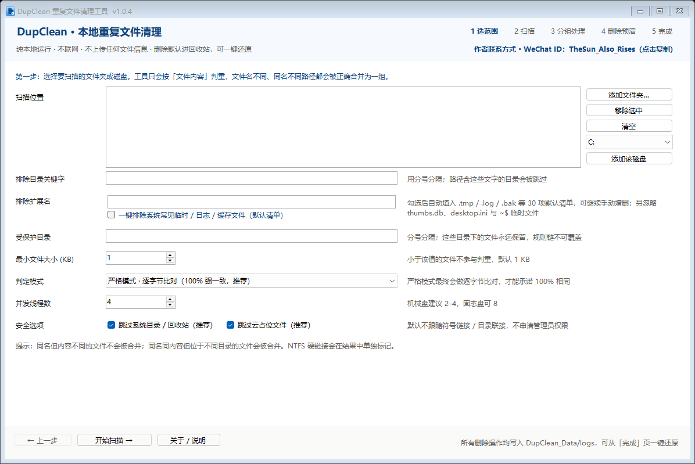
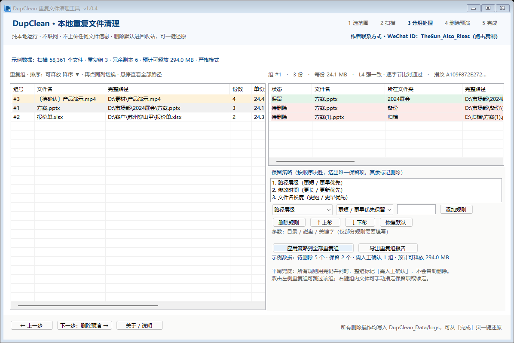

# DupClean · 本地重复文件清理工具

纯本地运行、不联网、不上传任何文件信息的 Windows 重复文件清理工具。按**文件内容**判重（而非文件名），把同名不同路径、改名副本、跨磁盘的相同文件合并为一组，再用可排序的规则链一键保留你想要的那一份、批量清理其余副本。




> 单文件 EXE，双击即用，无需安装 .NET 运行时，不需要管理员权限。

## 功能特性

- **分级判重**：大小分桶 → 头/中/尾三段采样哈希 → 全文件 SHA-256 → **逐字节比对**（严格模式）。哈希碰撞理论上存在，只有逐字节比对才承诺「100% 相同」。
- **只认内容、不认名字**：文件名不同、同名不同路径、异名同内容都正确合并；同名但内容差 1 字节绝不并组。
- **三档判定模式**：严格（含逐字节校验，推荐）/ 均衡（SHA-256 高置信）/ 快速（仅粗筛，禁止直接删除）。
- **可排序规则链**：文件名/文件夹名/完整路径长度、路径层级深浅、创建/修改时间新旧、优先目录或磁盘、关键字降权、副本命名降权、只读降权、受保护路径锁定。选「保留哪一份」，平局挂起人工确认。
- **安全删除四道防线**：每组至少留 1 份 → 删除前预演清单（可导出 CSV）→ 二次确认 → 默认进回收站 + 操作日志 + 一键还原。永久删除默认关闭。
- **工程边界**：跳过系统目录/回收站/符号链接/云占位文件；识别 NTFS 硬链接（不计入可释放空间）；支持超长中文路径；纯本地零联网。
- **界面交互**：五步向导、重复组虚拟列表（点击列头排序）、组内详情、右键手动覆盖、完成页还原入口。

## 技术栈

- .NET 8 + Windows Forms（`Microsoft.NET.Sdk.WindowsDesktop`）
- 发布方式：`self-contained` 单文件，目标 `win-x64`，Windows 10 1607+ / 11
- 全部依赖为 .NET 内置库（MIT），**未引入任何第三方 NuGet 包**，无 Qt/PyQt 等 GPL/LGPL 组件

## 构建

需要 .NET 8 SDK（`dotnet --version` 验证）。在 `src/` 目录下执行：

```bash
# 生成可双击运行的单文件 EXE 到 src/publish/
dotnet publish -c Release -r win-x64 --self-contained true -o publish
```

产物 `publish/DupClean.exe` 即为最终分发文件。

## 使用

1. **选范围**：添加文件夹或整块磁盘，按需设置排除目录、排除扩展名、受保护目录、最小文件大小、判定模式、并发线程数。
2. **扫描**：分级漏斗自动过滤，仅对少量候选读取完整内容。
3. **分组处理**：重复组合并展示，右侧看组内文件与保留策略；点击列头可排序。
4. **删除预演**：核对清单与可释放空间，导出 CSV 留档，二次确认后执行。
5. **完成**：默认移入回收站，可从日志一键还原。

命令行（无界面）：

```bash
DupClean.exe --cli-scan <目录>      # 命令行扫描并输出重复组
DupClean.exe --selftest [测试目录]  # 运行内置验收自测
DupClean.exe --uitest               # 校验界面构造
DupClean.exe --uishot <图片目录>    # 导出各步骤界面截图用于核对布局
```

## 目录结构

```
DupClean/
├── src/                  # 全部源码（DupClean.csproj、*.cs、app.manifest、app.ico）
│   ├── MainForm.cs       # 五步向导界面与交互
│   ├── Scanner.cs        # 分级判重与分组引擎
│   ├── Hashing.cs        # 采样哈希 / SHA-256 / 逐字节比对
│   ├── PolicyEngine.cs   # 可排序规则链
│   ├── SafeDelete.cs     # 回收站删除、日志、一键还原
│   ├── Models.cs         # 数据模型
│   ├── NativeMethods.cs  # 回收站 / 文件系统 P/Invoke
│   ├── SelfTest.cs       # 内置验收自测
│   ├── UiShot.cs         # 离线界面渲染自检（开发用）
│   └── Program.cs        # 程序入口与命令行分发
├── assets/               # 图标源文件与生成脚本（build_icon.py）
├── docs/
│   ├── PRD.md            # 产品需求文档
│   └── screenshots/      # 界面预览图
├── LICENSE               # MIT
└── README.md
```

## 许可证

本项目以 [MIT License](LICENSE) 开源。作者联系方式见软件主界面「关于 / 说明」或页眉（WeChat ID：TheSun_Also_Rises）。

## 免责声明

本工具删除操作默认进入 Windows 回收站，仍可能不可恢复；请在执行删除前核对预演清单，并对重要数据另行备份。作者不对任何数据丢失承担责任。
